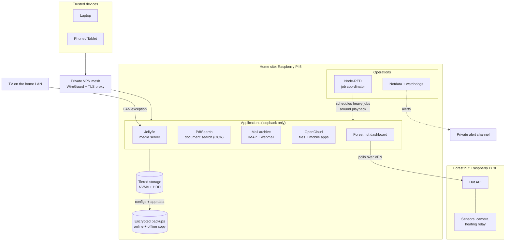

# Raspberry Pi Homelab

Documentation of the self-hosted home server infrastructure I design, run and maintain in my spare time.
It covers a **Raspberry Pi 5 main server** at home and a **Raspberry Pi 3B edge node** at a remote forest hut, connected through a private VPN mesh.

> This repository is documentation only. It describes architecture, design decisions and operating practices.
> Application source code lives in separate repositories (for example [Pdf-SearchEngine](https://github.com/KTV02/Pdf-SearchEngine)).
> Hostnames, addresses, ports, credentials and exact security configuration are intentionally left out.

## At a glance

| Area | What I run | Highlights |
|---|---|---|
| Platform | Raspberry Pi 5 (8 GB, ARM64, Debian 13) + Raspberry Pi 3B | systemd services and Docker Compose stacks side by side |
| Remote access | WireGuard-based VPN mesh (Tailscale) | **Zero ports exposed to the internet**, TLS for every web UI |
| Storage | 2× NVMe, 3× HDD, external SSD | Tiered media storage with mergerfs, dedicated HDD for cloud storage |
| Applications | Jellyfin, OpenCloud, PdfSearch, mail archive, forest hut dashboard, Node-RED | Several self-developed applications |
| Automation | Node-RED job coordinator | Schedules heavy jobs around media playback with locks and heartbeats |
| IoT | Temperature/humidity sensor, PIR, camera, smart relay | Autonomous frost protection heating at the hut |
| Backup | restic, encrypted | Versioned online repository + offline copy on a disconnected SSD |
| Monitoring | Netdata, custom watchdogs, CVE scanning | Alerts pushed to a private chat channel |

## High-level architecture

Web applications bind to the loopback interface. The VPN mesh provides a TLS endpoint for each of them that is reachable only from authenticated devices in my private network. The one deliberate exception is the media server, which TVs on the home LAN can reach directly. Nothing is published to the public internet.

## Documentation

| Topic | Page |
|---|---|
| Overall architecture and both sites | [docs/architecture.md](docs/architecture.md) |
| Hardware | [docs/hardware.md](docs/hardware.md) |
| Networking and remote access | [docs/networking.md](docs/networking.md) |
| Storage tiering | [docs/storage.md](docs/storage.md) |
| Services and applications | [docs/services/](docs/services/README.md) |
| Automation and job coordination | [docs/services/job-coordinator.md](docs/services/job-coordinator.md) |
| Backup and recovery | [docs/backup-recovery.md](docs/backup-recovery.md) |
| Monitoring and alerting | [docs/monitoring.md](docs/monitoring.md) |
| Security principles | [docs/security.md](docs/security.md) |
| Roadmap / Changelog | [ROADMAP.md](ROADMAP.md) / [CHANGELOG.md](CHANGELOG.md) |

### Services

| Service | Type | Description |
|---|---|---|
| [Jellyfin](docs/services/jellyfin.md) | Off-the-shelf | Personal media server for my own films, series, music and audiobooks |
| [OpenCloud](docs/services/opencloud.md) | Off-the-shelf, custom deployment | Personal cloud storage with web UI and mobile apps, three access gates and a CPU governor that protects media playback |
| [PdfSearch](docs/services/pdfsearch.md) | **Self-developed** | OCR, full-text indexing and search for PDF documents ([source](https://github.com/KTV02/Pdf-SearchEngine)) |
| [Mail archive](docs/services/mail-archive.md) | **Self-developed** | Tamper-evident long-term archive of my mailboxes, served read-only via IMAP and webmail |
| [Forest hut IoT](docs/services/forest-hut.md) | **Self-developed** | Sensor logging, camera, and autonomous frost protection heating at a remote site |
| [Job coordinator](docs/services/job-coordinator.md) | **Self-developed** (Node-RED) | Central scheduler for heavy background jobs |
| [Monitoring](docs/monitoring.md) | Off-the-shelf + custom | Netdata, watchdogs, security bulletin feed, container CVE scans |

## Skills demonstrated

- **Linux system administration**: Debian on ARM, systemd units, timers and resource control (cgroups), journald, users and permissions, sudo scoping
- **Containers**: Docker Compose, hardened containers (non-root, read-only root FS, dropped capabilities, `no-new-privileges`), internal networks
- **Networking**: VPN mesh design, reverse proxying with TLS, identity-aware access control, OpenID Connect, loopback-only binding, host and container firewalling for IPv4 and IPv6
- **Storage**: ext4, union filesystems (mergerfs), capacity planning, SMART monitoring
- **Backup and DR**: encrypted, deduplicated, versioned backups, offline copies, restore testing
- **Automation**: Node-RED flows, REST APIs, job queues with locks and heartbeats
- **Software development**: Python (Flask, FastAPI), SQLite, nginx, OCR pipelines, IoT hardware (I²C, GPIO, camera)
- **Operations**: monitoring and alerting, vulnerability scanning, controlled update procedures, documentation
