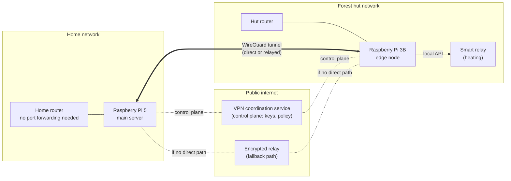
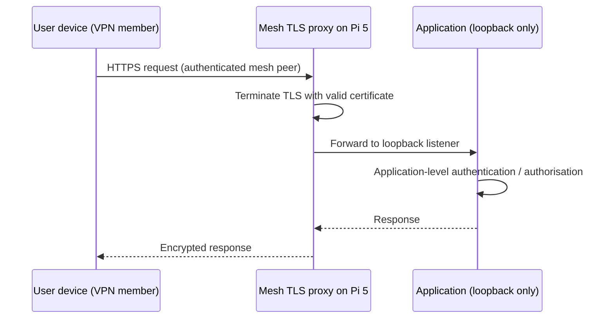

# Architecture

The homelab consists of two sites that are joined into one private network by a WireGuard-based VPN mesh.

| Site | Device | Role |
|---|---|---|
| Home | Raspberry Pi 5 | Main server: applications, private DNS, storage, automation, monitoring, backups |
| Forest hut (remote, cellular/Wi-Fi uplink) | Raspberry Pi 3B | Edge node: sensors, camera, heating control, local API |

## Design goals

1. **Nothing reachable from the public internet.** All access goes through the VPN mesh.
2. **Private ingress.** Web applications listen on loopback and use the mesh TLS proxy. DNS uses a dedicated listener on the VPN interface.
3. **Media playback is the top priority.** Heavy background work yields while someone is watching.
4. **Remote site is autonomous.** The hut keeps itself frost-free even if the home server or the uplink is down.
5. **Data is recoverable.** Encrypted, versioned backups plus an offline copy that ransomware cannot reach.
6. **Problems come to me.** Important failures are pushed as alerts instead of waiting to be discovered.

## Two-site setup

The VPN mesh establishes a direct peer-to-peer tunnel whenever NAT traversal succeeds and falls back to an end-to-end encrypted relay otherwise. The design does not need port forwarding on either router.

## Request flow for a web application

Two independent gates protect every application: only authenticated mesh peers reach the proxy at all, and the application itself still enforces its own login and permissions.

## Private DNS

Authorized clients send DNS queries over the VPN to CoreDNS on the home server. CoreDNS forwards them to Pi-hole on loopback and can use encrypted public DNS if Pi-hole becomes unavailable. The Pi-hole admin page follows the private HTTPS flow above. The public resolver available to clients during a home server outage can also answer while Pi-hole is healthy, so filtering is best-effort in that configuration. [Private DNS filtering](dns-filtering.md)

## Runtime model

| Layer | Used for |
|---|---|
| Native systemd services | Jellyfin (direct hardware access), OpenCloud, Node-RED, CoreDNS, forest hut dashboard, hut API |
| Docker Compose stacks | PdfSearch, mail archive, Pi-hole and further application stacks |
| systemd timers | Backups, watchdogs, scans, maintenance jobs |
| Node-RED | Coordination of heavy jobs, notification flows |

See also: [networking](networking.md), [storage](storage.md), [services](services/README.md).
