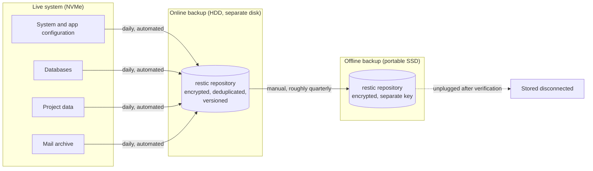

# Backup and recovery

## Strategy

The setup is modelled on the **3-2-1 rule**: three copies of important data (live data, an encrypted online backup on a different disk, and an encrypted offline copy on a separate device that is disconnected between runs).

## What is backed up

| Included | Excluded (and why) |
|---|---|
| System configuration, service definitions | Media library (large, non-critical) |
| Application data and databases (consistent dumps) | Caches, temporary files |
| Selected project directories | |
| Mail archive: database snapshot, manifest, original messages, deployed code | |

## Online backups

- [restic](https://restic.net/) with client-side encryption and deduplication
- A timer checks hourly whether the daily backup is due, so missed runs (e.g. after downtime) are caught up automatically
- Retention: daily, weekly and monthly snapshots are kept for a rolling window
- Separate maintenance runs prune old snapshots and verify repository integrity
- **Playback guard:** backup and maintenance work yields while media is being streamed
- Failed backup and maintenance runs trigger an alert

## Offline backups

- A separate restic repository on a portable SSD with its **own password, which is not stored on the server**
- Refreshed manually about every three months; a daily reminder alerts when a refresh is due
- The refresh only accepts a recent online snapshot, verifies the result and safely unmounts the disk afterwards
- Being disconnected, this copy is protected against ransomware, accidental deletion and server compromise

## Recovery principles

- Restores go to a separate directory first and are verified before anything is swapped; running databases are never overwritten with old copies.
- Application-specific consistency rules are respected. For example, a mail archive rollback never loses the record of messages already removed from the provider.
- The mail archive goes further and **proves restorability automatically**: a test restore is checksummed and produces a signed proof, which is a precondition before any message is deleted at the provider (see [mail archive](services/mail-archive.md)).
- Restorability is verified with test restores rather than assumed.
