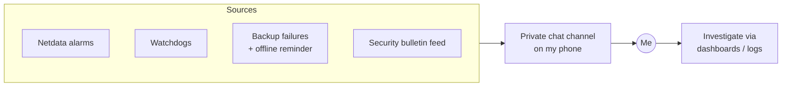

# Monitoring and alerting

## Components

| Component | Watches |
|---|---|
| [Netdata](https://www.netdata.cloud/) | CPU, memory, temperatures, disk usage and I/O, network, containers |
| Storage watchdog | Free space on the data disks |
| Boot monitor | System state after a reboot |
| Backup monitor | Backup age, failed backup or maintenance runs, offline backup due date |
| Container vulnerability scan | Weekly CVE scan of running images ([Trivy](https://trivy.dev/)) |
| Image update check | Newer upstream versions of deployed images |
| Security bulletin flow | VPN vendor security bulletins (RSS), deduplicated |
| Application health endpoints | Mail archive integrity, hut node sensors / camera / heating controller |
| Antivirus | Documents added to PdfSearch are virus-scanned (ClamAV) |

## Alert flow

## Design decisions

- Alerts from different tools end up in the same private chat, so nothing gets lost across dashboards.
- The security bulletin flow deduplicates persistently and queues messages, so its initial baseline does not flood the channel.
- Scan results, dashboards and application health endpoints complement the push alerts for investigation.
- Backup monitoring checks the age of the newest snapshot, not just exit codes, so a run that succeeded without producing data is still noticed.
- Webhook URLs and tokens are kept in environment or credential files, never in exported flows or code.
