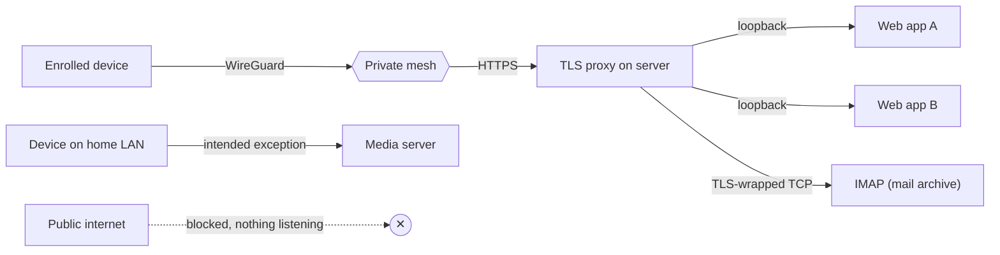

# Networking and remote access

## Principles

- **No inbound ports needed.** The design requires no port forwarding and no public DNS records pointing at home.
- **VPN mesh only.** Every device that may access the server is an enrolled, authenticated member of a private WireGuard-based mesh (Tailscale). Access is controlled per device and revocable at any time.
- **Loopback binding.** Applications listen on `localhost`. They are not reachable even from the local LAN unless explicitly intended (e.g. the TV in the living room using the media server).
- **TLS everywhere.** A TLS-terminating proxy built into the mesh publishes each service with a valid certificate inside the private network. Public exposure features of the mesh are not used.
- **Site-to-site over the same mesh.** The home server talks to the hut node over an encrypted tunnel; there is no separate site-to-site VPN to maintain.

## Access paths

## Container networking

- Each Compose stack has its own bridge network.
- Back-end components that do not need internet access (e.g. the IMAP server and webmail of the mail archive, the virus scanner) sit on networks without outbound internet.
- Containers that must talk to host services (e.g. the job coordinator) reach them through a restricted proxy that only allows the specific endpoints they need, authenticated with per-client tokens.
- A host firewall plus an additional filter in front of Docker's own forwarding rules prevents published container ports from bypassing the host firewall, which is a common Docker pitfall. Rules cover IPv4 and IPv6 and are re-applied automatically after reboots and Docker or firewall reloads.

## Remote administration

- SSH with key-based authentication; from outside the home network only through the mesh
- Administrative privileges require interactive authentication; narrowly scoped exceptions exist for single automation commands
- No remote desktop or management interface is exposed outside the mesh

See [security principles](security.md) for the broader approach.
