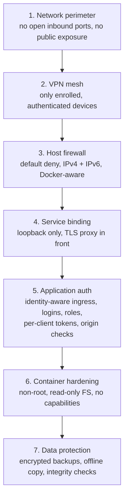

# Security principles

This page describes *how I think about* securing the homelab. Exact rules, addresses and configuration are deliberately not published.

## Defence in depth

## Principles applied

**Minimise attack surface**
- Zero ports reachable from the internet; the mesh is the only way in.
- Services listen on loopback; unused system services are disabled.
- Public exposure features of the VPN mesh are not used.

**Least privilege**
- Containers run as unprivileged users with read-only root filesystems, all Linux capabilities dropped and `no-new-privileges`.
- No container gets access to the Docker socket unless it is unavoidable.
- Media parsers and file processors run unprivileged; only a minimal helper performs privileged file operations.
- Administrative `sudo` requires interactive authentication; automation gets narrowly scoped exceptions, not blanket rights.
- Automated clients of the job coordinator have their own tokens and may only manage their own jobs.
- Where it adds value, access is tied to the verified mesh identity of the user, not just to the device (e.g. [OpenCloud](services/opencloud.md) admits only approved mesh users before its own login).

**Segmentation**
- Each application stack has its own container network.
- Components that need no internet access, such as the mail archive's IMAP and webmail containers, are kept on networks without outbound connectivity.
- Containers that need a host service (e.g. the job coordinator) reach it through a restricted, authenticated proxy.

**Secrets management**
- Secrets live in private configuration or credential files with tight permissions, or are encrypted at rest with keys provided through systemd credentials.
- No secrets in code, flows, browser code, logs or Git. Public source code is maintained separately from private deployment values.
- Signing keys for security-relevant proofs are isolated from the services that consume them.

**Integrity and recoverability**
- Mail archive originals are stored immutably with SHA-256 checksums and an HMAC-chained audit log.
- Backups are encrypted client-side; an offline copy is kept disconnected.

**Continuous review**
- Weekly container CVE scans and upstream update checks.
- Controlled, manual container updates: dry run first, configuration backed up before recreation, no blanket pruning and no automatic downgrades after database migrations.
- Subscribed to the VPN vendor's security bulletins.
- Firewall changes are tested in practice for both IPv4 and IPv6, not just written.
- Periodic security reviews of my own applications; findings are tracked and addressed.

## Out of scope for this repository

Firewall rule sets, access control policies, network addresses, hostnames, ports, accounts and any known open findings are intentionally not documented here.
