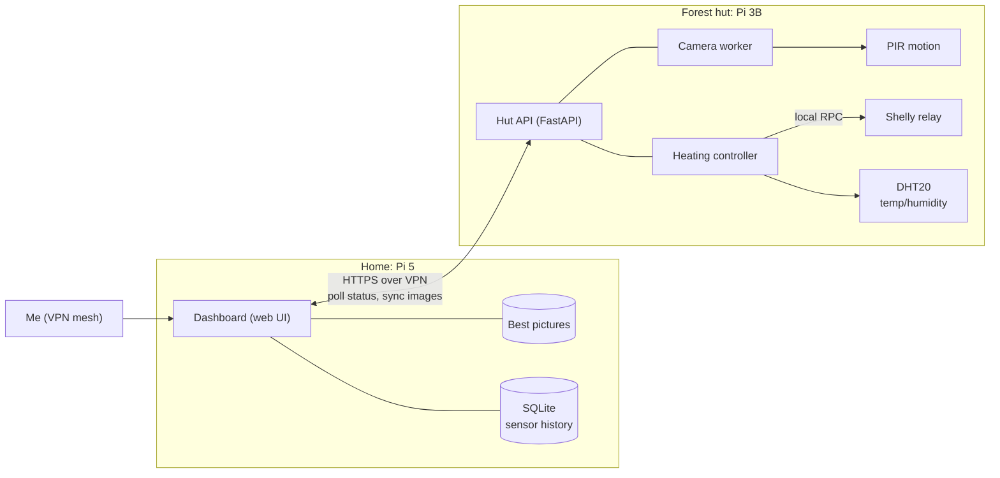
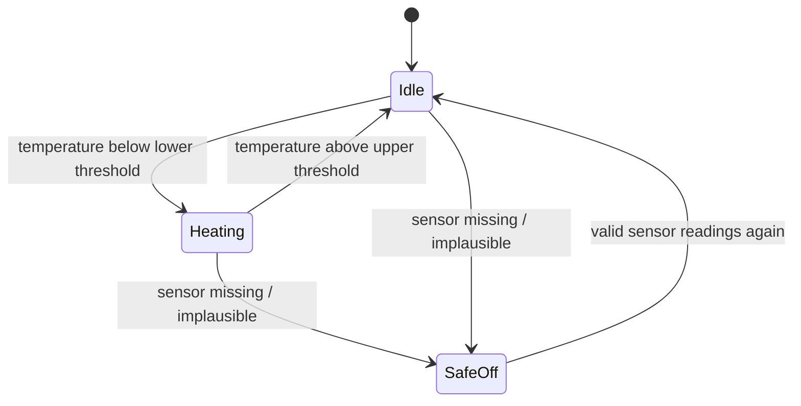

# Forest hut IoT

> A Raspberry Pi 3B at a remote forest hut monitors temperature, humidity and motion, takes camera pictures and keeps the hut frost-free. The home server stores the history and provides the dashboard.

| | |
|---|---|
| Type | **Self-developed** |
| Runtime | Native systemd services on both Pis (auto-start, auto-restart) |
| Main technologies | Python, FastAPI, SQLite, I²C / GPIO, libcamera, Shelly local RPC API |
| Status | In production |

## Overview

## Sensor logging and camera

- The dashboard polls the hut API, stores sensor readings every few minutes and caches the live status briefly to keep the cellular/Wi-Fi link light.
- The camera takes scheduled pictures during daytime hours and additional pictures when motion is detected (with a cooldown).
- Each day the best few pictures are selected automatically (image quality scoring) and synchronised to the home server; the hut node keeps only a short local history.
- A short, low-resolution live stream is available on demand with a hard time limit.
- The dashboard also shows link status and data usage of the hut uplink.

## Autonomous heating control

The heating logic runs **locally on the hut node**, not on the home server. The hut stays protected even when the dashboard is closed, the home server is offline or the uplink fails.

- **Frost protection** with hysteresis (heating on at 7 °C, off at 10 °C)
- **Stay mode**: a time-limited comfort temperature for visits, which returns to frost protection automatically
- **Safety**: heating requires a valid sensor reading; a safety check runs every 30 seconds; the Shelly relay has its own watchdog so it switches off if the controller stops talking to it; an optional maximum on-time can be configured
- The relay is controlled through its **local API**, independent of any vendor cloud

## Lessons learned

- Behind a mobile uplink a direct peer-to-peer VPN path is not always possible. Encrypted relaying keeps the site reachable without opening any ports.
- Safety-critical logic belongs as close to the hardware as possible.
