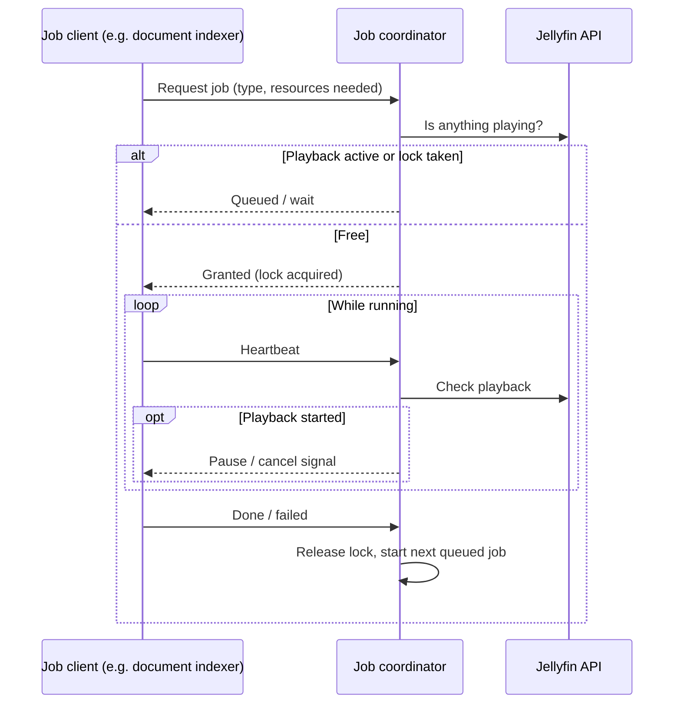

# Job coordinator (Node-RED)

> A central scheduler that decides **when** heavy background work may run on a small server, so that media playback always stays smooth.

| | |
|---|---|
| Type | **Self-developed** flows on [Node-RED](https://nodered.org/) with FlowFuse Dashboard 2.0 |
| Runtime | Native systemd service, loopback only |
| Status | In production |

## Problem

A Raspberry Pi has limited CPU, RAM and disk I/O. OCR indexing, moving media between disks, SMART long tests or backups can each saturate the system. If they start while someone is streaming a film, playback stutters.

## Concept

The coordinator does **not** run the heavy programs itself. External programs ask it for permission, report heartbeats and report completion, failure or cancellation. The coordinator keeps a queue and named locks.

## Locks and job types

| Lock (examples) | Purpose |
|---|---|
| HDD-heavy | Only one I/O-heavy job on the HDD at a time |
| SMART long test | SMART long self-tests never overlap with heavy disk work |

| Job type (examples) | Description |
|---|---|
| Document indexing | OCR and full-text indexing for [PdfSearch](pdfsearch.md) |
| Media mover | Moves aged media from the NVMe tier to the HDD tier ([storage](../storage.md)) |
| SMART long test | Periodic full disk self-tests |

## Rules

- Active playback blocks new matching jobs; cooperative running jobs get a pause or cancel signal.
- Jellyfin itself is never stopped, restarted or throttled.
- The coordinator only *observes* system services and containers; it imposes no blanket CPU/RAM limits.
- Independent safety mechanisms (storage watchdog, backup playback guard, the [OpenCloud](opencloud.md) resource governor) work without the coordinator, so it is not a single point of failure.

## Security

- Editor, admin functions and the dashboard require login; dashboard websockets are protected.
- Automated clients use separate, restricted tokens and may only manage their own jobs.
- Containers reach the coordinator only through a restricted proxy that exposes just the health and job endpoints.
- Anonymous health queries return minimal status only.
- Coordinator secrets are encrypted at rest; the master key is provided through systemd credentials.

## Other flows

- **Security bulletin alerts**: polls the VPN vendor's security bulletin feed and posts new entries to my alert channel, with persistent deduplication and a send queue.
