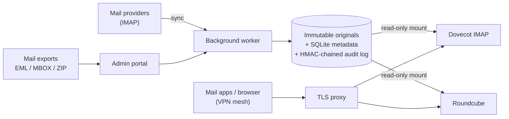
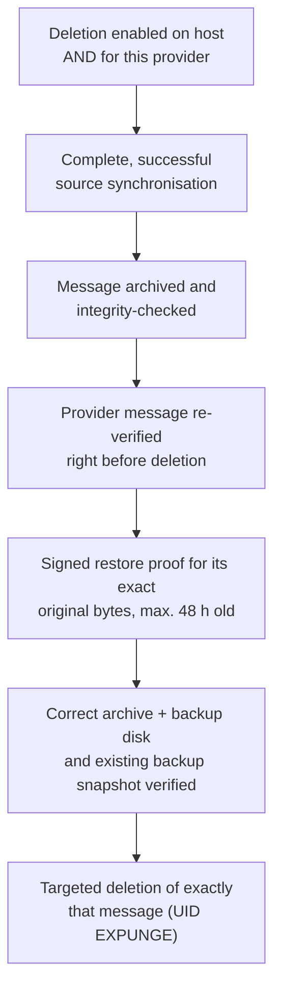

# Mail archive

> Self-developed, tamper-evident long-term archive for my personal mailboxes. It frees up space at the mail provider while keeping every message searchable and readable from any mail app.

| | |
|---|---|
| Type | **Self-developed** |
| Runtime | Docker Compose (portal, background worker, Dovecot, Roundcube, two nginx proxies) |
| Main technologies | Python, SQLite, Dovecot (IMAP), Roundcube (webmail), nginx |
| Status | In production |

## What it does

- Periodically synchronises configured provider mailboxes over IMAP (OAuth support for large providers is implemented)
- Imports historical mail from EML, MBOX and ZIP/Maildir exports
- Stores every message **immutably** together with its SHA-256 checksum and provenance
- Deduplicates logically identical messages (MIME-based) while keeping every distinct original variant
- Serves the archive **read-only** via IMAP (for any mail client) and webmail, separately per archive account
- Optionally deletes messages at the provider after a configurable age, but only after their safe archival has been proven

## Architecture

## Safe deletion at the provider

Deleting mail at the source is the dangerous part, so it is gated by several independent conditions. A message is only removed at the provider if **all** of the following hold:

The restore proof comes from a separate backup-check service that restores the message from the backup into a scratch location, compares checksums and signs the result. Its signing key is not available to the portal or the worker, so a compromised web component cannot forge a proof.

## Hardening

- All containers run as unprivileged users with read-only root filesystems, no Linux capabilities and `no-new-privileges`
- No Docker socket in the stack
- IMAP and webmail containers have no internet access
- Admin login is separate from archive accounts; every archive account has its own data area and credentials
- Provider credentials are encrypted at rest
- No SMTP: the archive cannot be used to send mail

## Honest scope

This is a private, tamper-evident archive with tested backups. It is not a certified WORM or legal-compliance archive.
