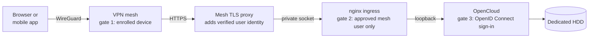
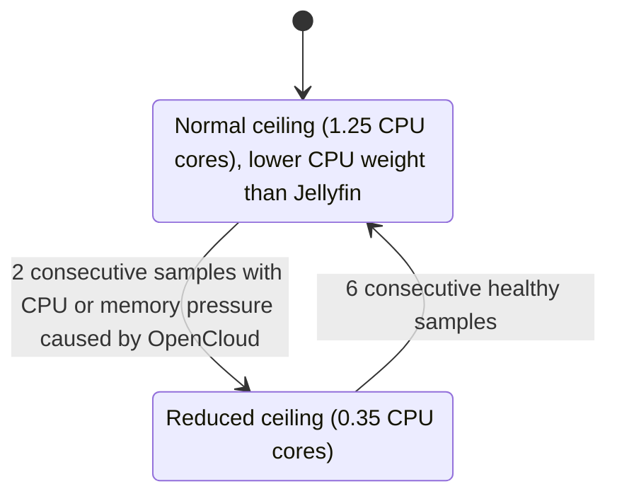

# OpenCloud (personal cloud storage / NAS)

> Self-hosted file storage with a modern web UI and official desktop-browser and mobile apps (iOS, Android), replacing my earlier lightweight file-sharing server.

| | |
|---|---|
| Type | Off-the-shelf ([OpenCloud](https://opencloud.eu/)), self-built deployment and resource governor |
| Runtime | Native ARM64 systemd services: application, ingress proxy, resource governor |
| Main technologies | OpenCloud (embedded OpenID Connect identity provider, POSIX storage), nginx, systemd resource control |
| Status | In production since 2026-11 |

## Why OpenCloud

I wanted a modern web interface for the desktop and official native apps for my phone, all reachable under the **same private URL**. OpenCloud is deployed in a deliberately lightweight form for the Pi: no separate database server, no office integration and no thumbnail rendering.

## Access chain

1. **Mesh membership:** only enrolled, authenticated devices can reach the service at all.
2. **Identity-aware ingress:** the mesh proxy passes the verified identity of the user on to nginx, which admits only explicitly approved accounts. Requests without an identity, or from any other mesh user, are rejected.
3. **Application login:** OpenCloud's own OpenID Connect sign-in with a separate username and password, in the browser or in the app's sign-in flow.

The proxy and nginx talk over a private Unix socket, and OpenCloud itself only listens on loopback. The service is not reachable from the home LAN.

**Token validation stays on the host.** OpenCloud validates tokens against its public HTTPS issuer. For the service, that issuer resolves to a restricted local listener that exposes only the OpenID discovery document, the signing keys and token-authenticated user info, protected by a certificate that only OpenCloud trusts. External clients still see the normal certificate of the mesh proxy.

## Storage

- All data lives on a **dedicated HDD**: configuration, files, upload temp files and proxy buffers. Large uploads therefore never fill the system or media SSDs.
- A storage guard checks, before startup, that the expected disk is mounted (filesystem identity and device type). The service depends on that mount, so it can never write to the wrong disk by accident.

## Sharing the Pi with media playback

Interactive uploads should keep working while someone is watching a film, without causing stutter. A small **resource governor** written for this deployment enforces that through systemd resource control:

- Samples every five seconds, so it reacts within seconds instead of minutes.
- Uploads are slowed down, not stopped.
- The governor works independently of the [job coordinator](job-coordinator.md). Node-RED only observes the services, so neither one is a single point of failure for the other.
- The health dashboard shows the service status and whether throttling is active.

## Migration

The previous file server was retired in a controlled cutover: its private route and services were removed, its content was copied into OpenCloud, and the original share was kept on disk as a fallback. A written runbook covers deployment and rollback.

## Verification

- Browser sign-in through the full access chain
- Byte-for-byte identical upload and download over HTTPS
- Rejection of requests with a missing or unapproved mesh identity
- No access from the home LAN
- Throttling and recovery of the CPU ceiling under load
- Healthy status in the health dashboard and the job coordinator
