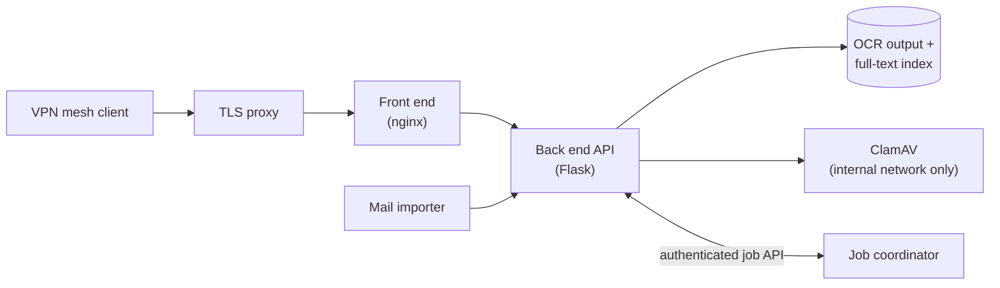

# PdfSearch

> Self-developed document management: upload, OCR, full-text search and preview for my PDF documents.

| | |
|---|---|
| Type | **Self-developed**, source: [KTV02/Pdf-SearchEngine](https://github.com/KTV02/Pdf-SearchEngine) |
| Runtime | Docker Compose |
| Main technologies | Python / Flask back end, nginx front end, OCR, full-text index, ClamAV |
| Status | In production |

The application itself (code, features, internals) is documented in its own repository. This page covers how it is **operated** on the home server.

## Deployment

- Containers for front end, back end, a mail-based document importer (PDF attachments) and an antivirus scanner on an internal network without internet access
- Cloud and folder synchronisation for selected document indexes
- Multi-user mode with per-index permissions; administrators are identified through the VPN mesh identity
- Explicit allowed browser origins; test bypasses disabled in production
- Heavy indexing jobs are registered with the [job coordinator](job-coordinator.md) through a restricted, token-authenticated endpoint, so they pause during media playback

## Separation of public code and private deployment

The public repository contains only source code. Environment files, Compose overrides, documents, mail and cloud credentials, and runtime data are kept in a separate private deployment configuration. Development happens in a separate working copy because production uses bind mounts.

## Operational notes

- No blanket CPU/RAM limits; heavy indexing is scheduled by the job coordinator around media playback instead.
- The document importer is independent of the [mail archive](mail-archive.md); they solve different problems.
