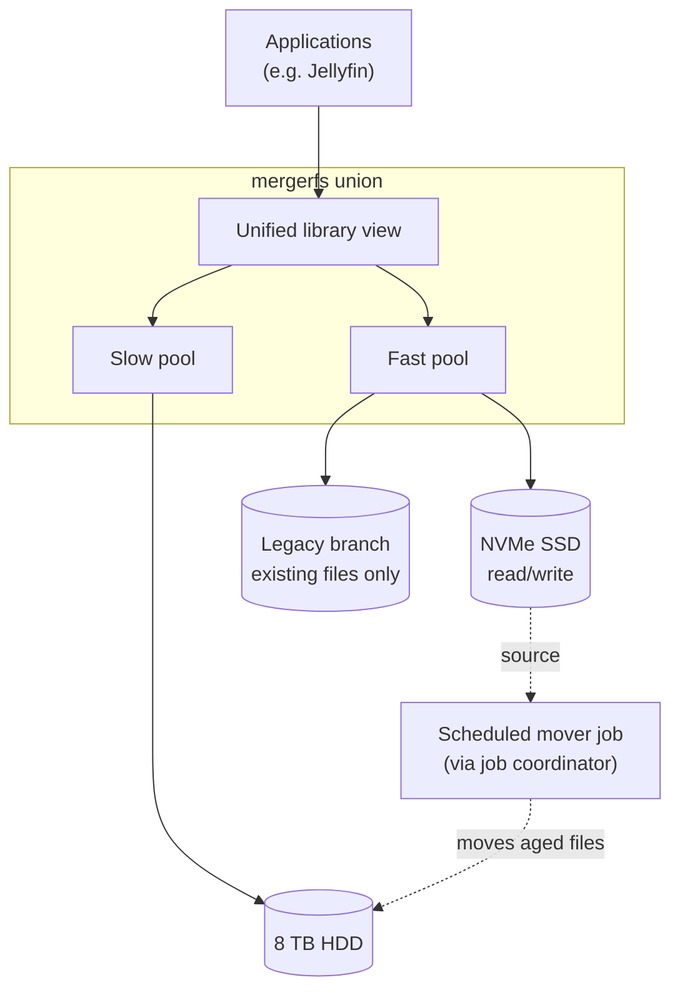

# Storage

## Layout

| Tier | Media | Purpose |
|---|---|---|
| System | NVMe SSD | OS, application code, databases, mail archive data |
| Fast tier | NVMe SSD | Recently added media, working and temporary data |
| Capacity tier | 8 TB HDD (+ spare HDDs) | Long-term media library, online backup repository |
| Offline | Portable SSD | Encrypted offline backup copy, disconnected between runs |

The internal disks use ext4. The Pi boots from NVMe; the SD card is not part of the running system.

## Tiering with mergerfs

The media library is presented to applications as **one** directory tree, although the files are spread over several physical disks. This is done with [mergerfs](https://github.com/trapexit/mergerfs), a union filesystem.

**Placement rules**

- New files are created on the fast NVMe branch as long as it has more than a configured minimum of free space; otherwise they fall through to the HDD.
- A legacy branch is marked "no create": existing files stay visible, but nothing new is written there, and its free space is not counted as usable capacity.
- A mover job relocates older files from NVMe to HDD. It runs through the [job coordinator](services/job-coordinator.md) so that it never competes with media playback for disk I/O.

## Design considerations

- **Union views are not additional capacity.** Several pools can be views on the same disks, so capacity planning is based on the physical disks.
- **mergerfs is not RAID.** It provides no redundancy. Important data is protected by [backups](backup-recovery.md); the media library is treated as non-critical.
- Disk health is checked with SMART, including periodic long self-tests that are scheduled by the job coordinator.
- A storage watchdog alerts on low free space before applications start failing.
